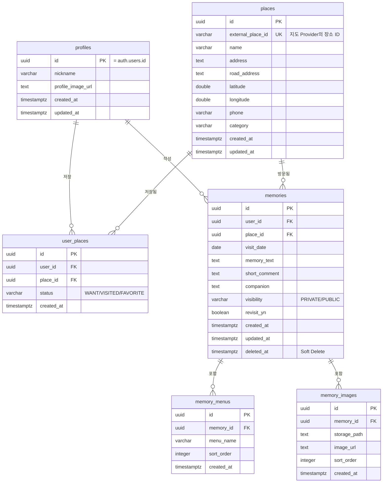

# 1단계 — 전체 시스템 Architecture / ERD / Supabase Table 설계 / RLS 구조

> 서비스 컨셉: "맛집을 저장하지 말고, 그날을 저장하세요."
> 이 문서는 개발 순서(31번 항목) 중 STEP 1~4에 해당하는 **설계 산출물**이다.
> 실제 실행 코드(SQL DDL, RLS Policy 문, Backend/Frontend 코드)는 이후 단계에서 별도 파일로 작성한다.

---

## 1. 전체 시스템 Architecture

### 1-1. 레이어 구조

```
┌─────────────────────────────────────────────┐
│  React Frontend (Vite + TS)                  │
│  - React Router / TanStack Query / Zustand   │
│  - Tailwind CSS, 반응형 UI                    │
│  - Kakao/Naver Map SDK (MapView로 추상화)     │
└───────────────┬───────────────────┬──────────┘
                │ (A) REST API       │ (B) Supabase SDK
                │ Authorization:     │  - 로그인/회원가입
                │ Bearer {accessToken}│ - 세션 갱신
                ▼                    ▼
┌───────────────────────────┐   ┌───────────────────┐
│ Node.js Backend (Express) │   │ Supabase Auth      │
│ Controller → Service      │──▶│ (JWT 발급/검증)     │
│           → Repository    │   └───────────────────┘
│ - 인증 미들웨어(JWT 검증)   │
│ - 공개범위(visibility) 검증│
│ - Memory CRUD 트랜잭션     │
└───────────────┬────────────┘
                │ Supabase JS (service role) / RPC
                ▼
┌─────────────────────────────────────────────┐
│ Supabase                                     │
│ - PostgreSQL (RLS 활성화)                     │
│ - Storage (memory-images bucket)             │
└─────────────────────────────────────────────┘
```

### 1-2. 핵심 원칙

| 원칙 | 설명 |
|---|---|
| Frontend는 DB를 직접 호출하지 않는다 | 장소 저장, Memory CRUD, 공개범위 조회 등 **비즈니스 로직이 포함된 모든 요청은 Backend REST API**를 통한다. |
| Supabase SDK 직접 사용 허용 범위 | 로그인/회원가입/세션 관리(Auth)만 Frontend에서 `supabase-js`로 직접 처리한다. |
| userId는 절대 신뢰하지 않는다 | 모든 요청은 `Authorization: Bearer {accessToken}`으로 오고, Backend `auth.middleware.ts`가 Supabase에 토큰을 검증해 `req.user.id`를 채운다. Request Body의 `userId`는 사용하지 않는다. |
| RLS는 2차 방어선 | Backend에서 권한을 검증하더라도, Supabase RLS를 반드시 함께 적용해 DB 레벨에서도 PRIVATE 데이터가 노출되지 않도록 이중으로 보호한다. |
| Service Role Key는 Backend 전용 | `SUPABASE_SERVICE_ROLE_KEY`는 Backend `.env`에만 존재하며 절대 Frontend에 노출되지 않는다. |

### 1-3. 인증 흐름 시퀀스

```
1. 사용자가 React에서 이메일/비밀번호로 로그인
2. Frontend: supabase.auth.signInWithPassword() 호출 (Supabase Auth 직접 사용)
3. Supabase Auth → accessToken(JWT), refreshToken 반환
4. Frontend: Zustand authStore에 세션 저장
5. 이후 Backend API 호출 시 Axios interceptor가
   Authorization: Bearer {accessToken} 헤더를 자동 첨부
6. Backend auth.middleware.ts:
   - supabase.auth.getUser(accessToken) 로 토큰 검증
   - 유효하면 req.user = { id, email } 주입
   - 무효하면 401 응답
7. Controller → Service → Repository는 req.user.id 를 신뢰 가능한
   사용자 식별자로 사용
```

### 1-4. Memory 생성 흐름 (쓰기 경로, Storage 포함)

이미지 업로드 실패 시 고아 데이터가 남지 않도록 **Memory 생성 → ID 확보 → 이미지 업로드 → memory_images 등록** 순서를 따른다 (30번 항목 반영).

```
POST /api/memories (menus 포함, images 제외)
  → memories + memory_menus 를 하나의 Supabase RPC(Transaction)로 생성
  → memoryId 반환
       │
       ▼
POST /api/memories/:memoryId/images (multipart)
  → Backend가 Storage에 업로드 (/{userId}/{memoryId}/{uuid}.jpg)
  → 성공한 파일만 memory_images 테이블에 INSERT
  → 업로드 중 일부 실패해도 이미 성공한 이미지는 유지, 실패 목록만 반환
```

---

## 2. ERD (Entity Relationship Diagram)



### 관계 요약

| 관계 | 카디널리티 | 비고 |
|---|---|---|
| `auth.users` – `profiles` | 1:1 | `profiles.id = auth.users.id`, 회원가입 시 Trigger 또는 Backend에서 함께 생성 |
| `profiles` – `user_places` | 1:N | 사용자가 저장한 장소 목록 |
| `places` – `user_places` | 1:N | 동일 장소를 여러 사용자가 각자 저장 가능 |
| `profiles` – `memories` | 1:N | 사용자의 방문 기록 |
| `places` – `memories` | 1:N | 한 장소에 여러 사용자의 여러 기록이 쌓임 |
| `memories` – `memory_menus` | 1:N | 한 방문에 여러 메뉴 |
| `memories` – `memory_images` | 1:N | 한 방문에 여러 사진 |

---

## 3. Supabase Table 설계

> 아래는 컬럼/제약조건 설계이며, 실제 `CREATE TABLE` DDL은 3단계(SQL Migration)에서 작성한다.

### 3-1. `profiles`

| 컬럼 | 타입 | 제약 | 설명 |
|---|---|---|---|
| id | uuid | PK, FK → auth.users.id | Supabase Auth 사용자와 1:1 |
| nickname | varchar(30) | NOT NULL | 표시 이름 |
| profile_image_url | text | NULL 허용 | Storage 공개 URL |
| created_at | timestamptz | NOT NULL, default now() | |
| updated_at | timestamptz | NOT NULL, default now() | |

- 신규 가입 시 `profiles` row가 없으면 다른 사용자의 PUBLIC 추억에 닉네임이 표시되지 않으므로, 가입 직후 자동 생성이 필요하다. Supabase `auth.users` INSERT 트리거로 자동 생성하는 방식을 4단계(SQL Migration)에서 함께 정의한다.

### 3-2. `places`

| 컬럼 | 타입 | 제약 | 설명 |
|---|---|---|---|
| id | uuid | PK, default gen_random_uuid() | |
| external_place_id | varchar(100) | UNIQUE, NULL 허용 | 지도 Provider(Kakao/Naver)의 장소 고유 ID. 동일 장소 중복 생성 방지 |
| name | varchar(200) | NOT NULL | |
| address | text | NULL 허용 | 지번 주소 |
| road_address | text | NULL 허용 | 도로명 주소 |
| latitude | double precision | NOT NULL | |
| longitude | double precision | NOT NULL | |
| phone | varchar(30) | NULL 허용 | |
| category | varchar(100) | NULL 허용 | |
| created_at | timestamptz | NOT NULL, default now() | |
| updated_at | timestamptz | NOT NULL, default now() | |

- **인덱스**: `(latitude, longitude)` 복합 인덱스 — Bounds 조회(`BETWEEN`)용. `external_place_id` UNIQUE 인덱스.
- 장소 저장(`POST /api/places`) 시 `external_place_id` 기준 `UPSERT`로 중복 생성을 막는다.

### 3-3. `user_places`

| 컬럼 | 타입 | 제약 | 설명 |
|---|---|---|---|
| id | uuid | PK, default gen_random_uuid() | |
| user_id | uuid | FK → profiles.id, NOT NULL | |
| place_id | uuid | FK → places.id, NOT NULL | |
| status | varchar(20) | NOT NULL, CHECK IN ('WANT','VISITED','FAVORITE') | |
| created_at | timestamptz | NOT NULL, default now() | |

- **UNIQUE(user_id, place_id)**: 같은 사용자가 같은 장소를 중복 저장하지 못하도록 함.
- **인덱스**: `user_id`, `place_id` 각각 조회용 인덱스.

### 3-4. `memories`

| 컬럼 | 타입 | 제약 | 설명 |
|---|---|---|---|
| id | uuid | PK, default gen_random_uuid() | |
| user_id | uuid | FK → profiles.id, NOT NULL | |
| place_id | uuid | FK → places.id, NOT NULL | |
| visit_date | date | NOT NULL | |
| memory_text | text | NOT NULL | 추억 본문 |
| short_comment | text | NULL 허용 | 한줄평 |
| companion | text | NULL 허용 | 함께 방문한 사람 |
| visibility | varchar(10) | NOT NULL, CHECK IN ('PRIVATE','PUBLIC'), default 'PRIVATE' | 확장 대비 varchar (향후 FRIENDS/GROUP 추가) |
| revisit_yn | boolean | NULL 허용 | |
| created_at | timestamptz | NOT NULL, default now() | |
| updated_at | timestamptz | NOT NULL, default now() | |
| deleted_at | timestamptz | NULL 허용 | Soft Delete 마커 |

- **인덱스**:
  - `(user_id, visit_date DESC)` — 내 타임라인 조회
  - `(place_id, visibility, deleted_at)` — 장소 상세의 공개 추억 조회 (`WHERE visibility='PUBLIC' AND deleted_at IS NULL`)
  - `(user_id, place_id)` — 장소 상세의 "내 추억" 조회
- 모든 조회 쿼리는 `deleted_at IS NULL` 조건을 기본 포함한다.

### 3-5. `memory_menus`

| 컬럼 | 타입 | 제약 | 설명 |
|---|---|---|---|
| id | uuid | PK, default gen_random_uuid() | |
| memory_id | uuid | FK → memories.id ON DELETE CASCADE, NOT NULL | |
| menu_name | varchar(100) | NOT NULL | |
| sort_order | integer | NOT NULL, default 0 | |
| created_at | timestamptz | NOT NULL, default now() | |

- **인덱스**: `memory_id`

### 3-6. `memory_images`

| 컬럼 | 타입 | 제약 | 설명 |
|---|---|---|---|
| id | uuid | PK, default gen_random_uuid() | |
| memory_id | uuid | FK → memories.id ON DELETE CASCADE, NOT NULL | |
| storage_path | text | NOT NULL | Storage 내부 경로 (`/{userId}/{memoryId}/{uuid}.jpg`) |
| image_url | text | NOT NULL | Public/Signed URL |
| sort_order | integer | NOT NULL, default 0 | |
| created_at | timestamptz | NOT NULL, default now() | |

- **인덱스**: `memory_id`
- `memory_menus`, `memory_images` 모두 `memories` 삭제(하드 삭제 시)와 함께 정리되도록 `ON DELETE CASCADE`를 건다. 단, `memories`는 Soft Delete를 쓰므로 실제 CASCADE가 발동하는 경우는 드물다(관리자 정리 등 예외 상황용).

### 3-7. Foreign Key / Index 설계 요약표

| 테이블 | FK | 참조 | ON DELETE |
|---|---|---|---|
| profiles | id | auth.users.id | CASCADE |
| user_places | user_id | profiles.id | CASCADE |
| user_places | place_id | places.id | CASCADE |
| memories | user_id | profiles.id | CASCADE |
| memories | place_id | places.id | RESTRICT (기록이 있는 장소는 실수로 삭제 방지) |
| memory_menus | memory_id | memories.id | CASCADE |
| memory_images | memory_id | memories.id | CASCADE |

---

## 4. Supabase RLS 구조

> 실제 `CREATE POLICY` SQL 문은 4단계(RLS Policy 작성)에서 작성한다. 여기서는 **정책 설계(Policy Matrix)** 만 정의한다.

### 4-1. 공통 원칙

- 모든 테이블에서 `ALTER TABLE ... ENABLE ROW LEVEL SECURITY` 를 적용한다.
- Backend는 원칙적으로 **Service Role Key**로 Supabase에 접속하여 RLS를 우회할 수 있지만, 애플리케이션 로직에서 항상 `user_id = req.user.id` 조건을 강제한다.
- RLS는 "Backend 로직 실수" 또는 "Anon Key로 클라이언트가 직접 호출하는 경우"에 대한 최종 방어선이다.
- `auth.uid()` 는 Supabase가 JWT에서 추출하는 현재 로그인 사용자 UUID이다.

### 4-2. 테이블별 Policy Matrix

| 테이블 | SELECT | INSERT | UPDATE | DELETE |
|---|---|---|---|---|
| `profiles` | 전체 공개 (닉네임/프로필 이미지는 다른 사용자도 조회 가능해야 PUBLIC 추억에 표시 가능) | `auth.uid() = id` 인 경우만 (본인 프로필만 생성) | `auth.uid() = id` | 미허용 (탈퇴는 별도 플로우) |
| `places` | 전체 공개 (장소 정보 자체는 개인정보 아님) | 인증된 사용자 누구나 (신규 장소 등록) | 인증된 사용자 누구나 허용하지 않음 — Backend에서만 UPSERT 처리 (RLS로는 차단하고 Service Role만 허용) | 미허용 |
| `user_places` | `auth.uid() = user_id` 인 경우만 | `auth.uid() = user_id` | `auth.uid() = user_id` | `auth.uid() = user_id` |
| `memories` | `auth.uid() = user_id` **OR** (`visibility = 'PUBLIC' AND deleted_at IS NULL`) | `auth.uid() = user_id` | `auth.uid() = user_id` | `auth.uid() = user_id` (실제로는 Soft Delete이므로 UPDATE 정책으로도 커버됨) |
| `memory_menus` | 상위 `memories` 기준 SELECT 가능 여부와 동일 (본인 것 또는 PUBLIC) — `EXISTS` 서브쿼리로 `memories` 조인 검사 | 상위 `memories.user_id = auth.uid()` | 상위 `memories.user_id = auth.uid()` | 상위 `memories.user_id = auth.uid()` |
| `memory_images` | `memory_menus`와 동일한 방식 (상위 memories 기준) | 상위 `memories.user_id = auth.uid()` | 상위 `memories.user_id = auth.uid()` | 상위 `memories.user_id = auth.uid()` |

### 4-3. 핵심 정책 예시 (개념 수준 의사코드 — 최종 SQL은 4단계에서 작성)

```
-- memories SELECT 정책 (개념)
USING (
  auth.uid() = user_id
  OR (visibility = 'PUBLIC' AND deleted_at IS NULL)
)

-- memories UPDATE / DELETE 정책 (개념)
USING (auth.uid() = user_id)
WITH CHECK (auth.uid() = user_id)

-- memory_menus SELECT 정책 (개념) — 상위 memories 기준 위임
USING (
  EXISTS (
    SELECT 1 FROM memories m
    WHERE m.id = memory_menus.memory_id
      AND (m.user_id = auth.uid() OR (m.visibility = 'PUBLIC' AND m.deleted_at IS NULL))
  )
)
```

### 4-4. Storage RLS (Bucket: `memory-images`)

| 정책 | 조건 |
|---|---|
| SELECT (읽기) | Public 버킷이므로 URL을 아는 사람은 조회 가능 (이미지 자체는 민감정보 아님으로 간주) — 단, PRIVATE 기록에 포함된 이미지 URL은 Backend가 PRIVATE 기록의 `image_url`을 응답에 포함하지 않도록 애플리케이션 레벨에서 차단 |
| INSERT (업로드) | `storage.objects` 경로의 첫 segment가 `auth.uid()`와 일치할 때만 허용 → 경로 규칙 `/{userId}/{memoryId}/{uuid}.jpg` 를 정책에서 `(storage.foldername(name))[1] = auth.uid()::text` 로 검사 |
| UPDATE / DELETE | 동일하게 경로의 `userId` segment가 본인일 때만 허용 |

### 4-5. Public API 조건 재확인 (27번 요구사항 반영)

- `GET /api/places/:placeId/memories/public` 은 Backend Repository 쿼리에서 반드시 `WHERE visibility = 'PUBLIC' AND deleted_at IS NULL` 을 명시적으로 포함한다.
- 이는 RLS가 이미 걸려 있어도 **Backend 레벨에서 이중으로 명시**하여, Service Role Key로 RLS를 우회하는 Backend 코드가 실수로 PRIVATE 데이터를 반환하지 않도록 방지한다.

---

## 다음 단계

이 문서는 STEP 1~4(아키텍처/폴더구조 중 Supabase 설계 부분/DB 설계/RLS 구조)에 대한 설계다. 다음으로 진행할 항목은:

1. **React / Backend 프로젝트 폴더 구조 실제 생성** (Vite/Express 초기 세팅)
2. **SQL Migration 파일 작성** (`CREATE TABLE`, 인덱스, 트리거)
3. **RLS Policy SQL 작성** (`CREATE POLICY`)

계속 진행할지, 혹은 이 설계에 대해 먼저 수정하고 싶은 부분이 있는지 확인 후 다음 단계로 넘어가겠습니다.
